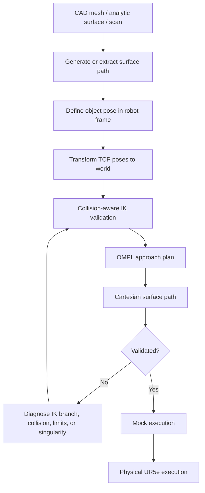
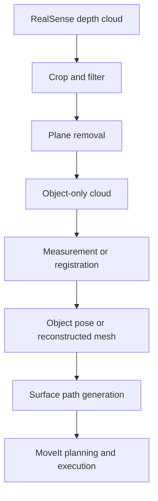
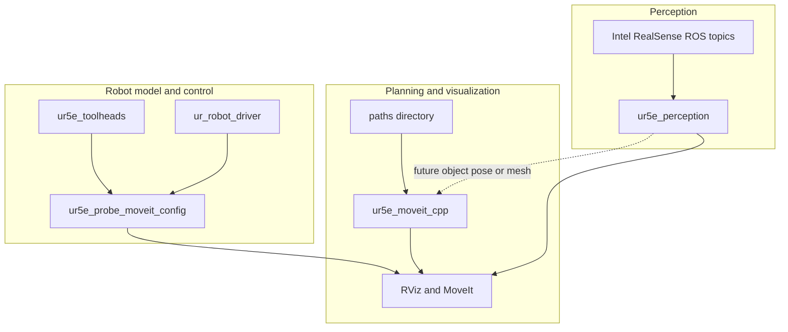
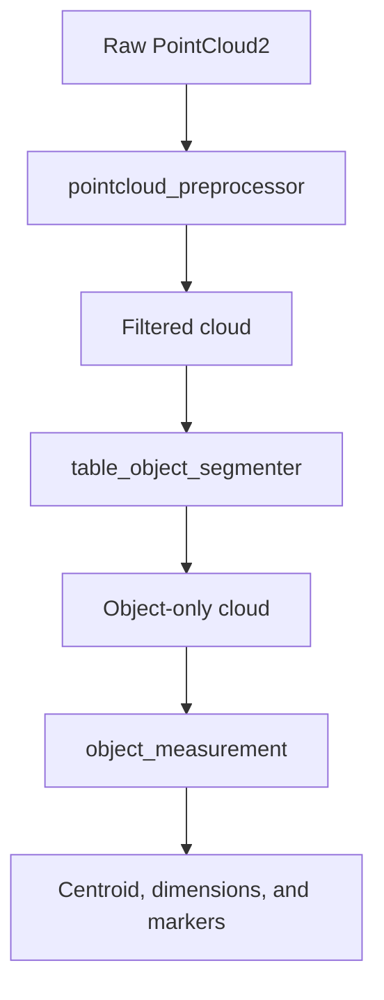
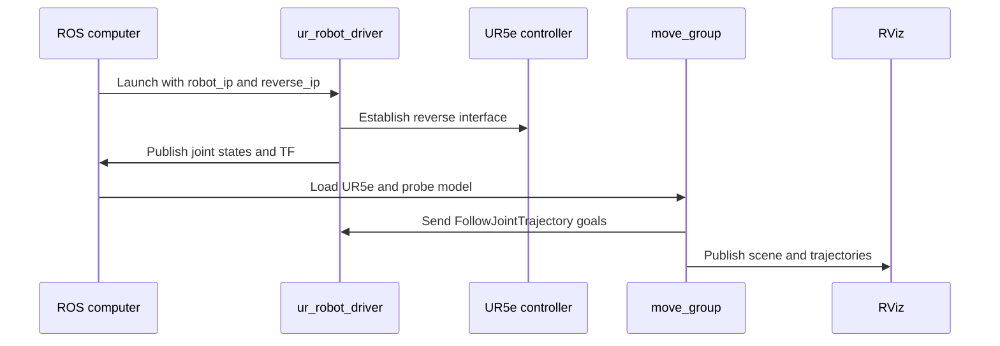
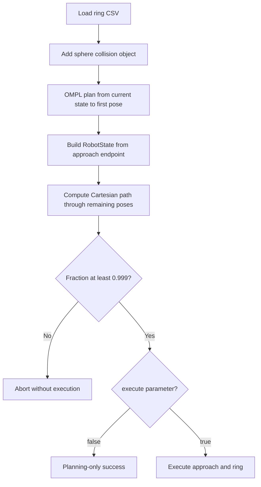
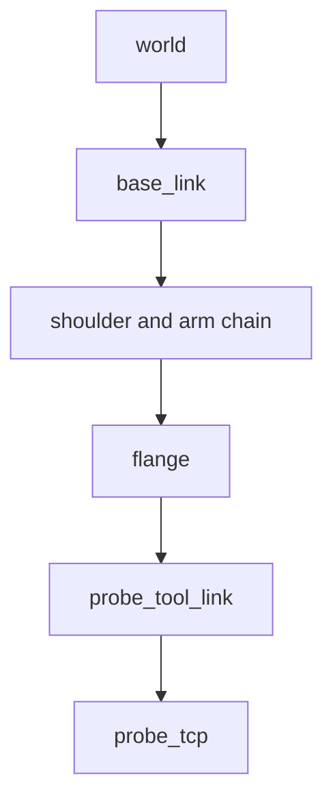

# UR5e Surface Printing ROS 2

> ROS 2 Jazzy + MoveIt 2 research workspace for curved-surface path generation, UR5e planning, custom tool integration, RealSense point-cloud processing, RViz visualization, mock execution, and physical-robot bring-up.

[](https://docs.ros.org/en/jazzy/)
[](https://moveit.picknik.ai/)
[](https://ubuntu.com/)
[](#)
[](src/ur5e_perception/LICENSE)

> [!WARNING]
> Several early demonstration nodes execute motion immediately after planning. Use mock hardware and RViz first. Review every target, frame, collision object, tool transform, controller, and speed before using the physical UR5e.

---


> **Integrated main:** New development from `demo/coarse-collision` and
> `demo/syringe-print` is included in `main`. The complete command and parameter
> guides complement the detailed explanations here:
> [COMMANDS.md](docs/COMMANDS.md), [PARAMETERS.md](docs/PARAMETERS.md),
> [GUI.md](docs/GUI.md), [hardware startup](docs/HARDWARE_STARTUP.md), and
> [demo runbook](docs/DEMO_RUNBOOK.md).

## Contents

- [Project overview](#project-overview)
- [System architecture](#system-architecture)
- [Repository layout](#repository-layout)
- [Packages](#packages)
- [Installation](#installation)
- [Build](#build)
- [Mock RViz workflow](#mock-rviz-workflow)
- [Physical UR5e workflow](#physical-ur5e-workflow)
- [Desktop GUI](#desktop-gui)
- [Syringe and bounded printing workflows](#syringe-and-bounded-printing-workflows)
- [Surface-path workflows](#surface-path-workflows)
- [RealSense perception workflow](#realsense-perception-workflow)
- [Executable reference](#executable-reference)
- [Coordinate frames and conventions](#coordinate-frames-and-conventions)
- [Current status](#current-status)
- [Known limitations](#known-limitations)
- [Useful diagnostics](#useful-diagnostics)
- [Development roadmap](#development-roadmap)
- [Validation](#validation)
- [License](#license)

---

## Project overview

This repository documents the development of a computation-focused robotic surface-printing pipeline. It progresses from basic MoveIt motion tests to custom end-effector modeling, collision-scene construction, trajectory analysis, curved-surface toolpath generation, point-cloud preprocessing, and real-robot launch integration.



Longer-term target:



---

## System architecture



The repository contains eight ROS packages, Mega firmware, offline validation tests,
and generated path data. `main` integrates the former `demo/coarse-collision`
and `demo/syringe-print` development histories:

| Component | Role |
|---|---|
| `ur5e_moveit_cpp` | Planning, trajectory analysis, collision objects, path visualization, and surface-following experiments |
| `ur5e_toolheads` | UR5e and custom probe/tool robot descriptions for mock and physical configurations |
| `ur5e_probe_moveit_config` | SRDF, kinematics, controllers, RViz, mock launch, and physical-robot MoveIt launch files |
| `ur5e_perception` | PCL-based RealSense point-cloud preprocessing, table removal, and object measurement |
| `surface_printing` | Capture/import paths, plan one registered line, independently check sampled TCP speed, and replay a saved bounded plan |
| `syringe_interfaces` | Pulse/volume actions and extrusion/flow services |
| `syringe_controller` | Exclusive serial pump backend, calibration estimates, leased flow, watchdog and STOP |
| `surface_printing_gui` | Desktop console for launches, offline geometry, path capture/registration, planning/checking, bounded robot/pump commands and logs |
| `firmware/` | Mega ramped PUL/DIR/ENA firmware, idle disable, pulse/time limits and heartbeat controls |
| `tests/` | Offline Python, GUI subprocess and firmware host checks |
| `paths/` | Hemisphere generator and generated CSV waypoint sets |

---

## Repository layout

```text
ur5e_surface_printing_ros2/
├── README.md
├── paths/
│   ├── generate_hemisphere_ring.py
│   ├── hemisphere_ring.csv
│   ├── hemisphere_ring_start_00.csv
│   ├── hemisphere_ring_start_01.csv
│   └── ...
└── src/
    ├── surface_printing_gui/      # Desktop operator console
    ├── surface_printing/          # Bounded saved-plan workflow
    ├── syringe_interfaces/        # Generated ROS interfaces
    ├── syringe_controller/        # Mega serial backend
    ├── ur5e_moveit_cpp/
    │   ├── CMakeLists.txt
    │   ├── package.xml
    │   ├── data/
    │   │   └── toolpaths/
    │   ├── meshes/
    │   └── src/
    │       ├── simple_joint_motion.cpp
    │       ├── simple_pose_motion.cpp
    │       ├── plan_only_trajectory.cpp
    │       ├── save_trajectory_csv.cpp
    │       ├── analyze_trajectory.cpp
    │       ├── compare_pose_candidates.cpp
    │       ├── add_box_only.cpp
    │       ├── collision_object_demo.cpp
    │       ├── collision_aware_candidate_planner.cpp
    │       ├── remove_all_objects.cpp
    │       ├── parameterized_shape_adder.cpp
    │       ├── hemisphere_surface_demo.cpp
    │       └── visualize_surface_toolpath.cpp
    ├── ur5e_toolheads/
    │   ├── launch/
    │   ├── meshes/
    │   └── urdf/
    ├── ur5e_probe_moveit_config/
    │   ├── config/
    │   └── launch/
    └── ur5e_perception/
        ├── CMakeLists.txt
        ├── package.xml
        ├── LICENSE
        └── src/
            ├── pointcloud_preprocessor.cpp
            ├── table_object_segmenter.cpp
            └── object_measurement.cpp
```

> [!NOTE]
> This repository is organized as a ROS workspace snapshot. ROS packages are stored under `src/`, while generated path data is stored in the top-level `paths/` directory.

---

## Packages

### `ur5e_moveit_cpp`

Core C++ package for MoveIt experimentation.

It includes:

- joint-space and pose-space motion examples;
- plan-only trajectory inspection;
- CSV trajectory export;
- trajectory quality metrics;
- candidate-pose comparison;
- collision-object insertion and cleanup;
- parameterized box, cylinder, and sphere insertion;
- raster toolpath and mesh visualization;
- collision-aware hemisphere approach and Cartesian path planning.

The package installs its `data/` and `meshes/` directories into the package share directory. This allows RViz nodes to use package resources such as:

```text
package://ur5e_moveit_cpp/meshes/apple_surface_z_up.stl
```

### `ur5e_toolheads`

Robot-description package for the custom tool.

Important frame chain:

```text
world
└── base_link
    └── UR5e arm links
        └── flange
            └── probe_tool_link
                └── probe_tcp
```

The tool is attached to the UR5e `flange`. The final planning TCP for the surface-following work is:

```text
probe_tcp
```

The package contains:

- reusable probe-tool xacro definitions;
- custom tool visual and collision geometry;
- mock UR5e robot descriptions;
- physical UR5e robot descriptions using `ur_robot_driver`;
- robot-state-publisher launch integration for the physical robot.

### `ur5e_probe_moveit_config`

MoveIt configuration adapted for the probe-equipped UR5e.

| Setting | Value |
|---|---|
| Planning group | `ur_manipulator` |
| Kinematic chain | `base_link` to `probe_tcp` |
| Planning frame | `world` |
| Virtual joint | Fixed `world` to `base_link` |
| IK solver | KDL |
| IK timeout | `0.05 s` |
| IK attempts | `10` |
| Default velocity scaling | `0.1` |
| Default acceleration scaling | `0.1` |
| Mock controller | `ur_manipulator_controller` |
| Physical controller | `scaled_joint_trajectory_controller` |

Mock launch:

```bash
export ROS_DOMAIN_ID=78
ros2 launch ur5e_probe_moveit_config demo.launch.py
```

Physical launch:

```bash
ros2 launch ur5e_probe_moveit_config real_robot.launch.py \
  robot_ip:=192.168.1.102 \
  reverse_ip:=192.168.1.100 \
  kinematics_params_file:="$HOME/ur5e_calibration.yaml" \
  launch_rviz:=true
```

### `ur5e_perception`

PCL-based RealSense processing package.



Executables:

- `pointcloud_preprocessor`
- `table_object_segmenter`
- `object_measurement`

Main dependencies:

- `rclcpp`
- `sensor_msgs`
- `geometry_msgs`
- `visualization_msgs`
- `pcl_conversions`
- `pcl_ros`
- PCL filters, search, and segmentation components

---

## Installation

### Base environment

The project has been developed using:

```text
Ubuntu 24.04
ROS 2 Jazzy
MoveIt 2
Universal Robots ROS 2 driver
Intel RealSense ROS wrapper
PCL
```

Install the main binary dependencies:

```bash
sudo apt update

sudo apt install \
  ros-jazzy-moveit \
  ros-jazzy-ur \
  ros-jazzy-ur-robot-driver \
  ros-jazzy-realsense2-camera \
  ros-jazzy-pcl-ros \
  ros-jazzy-pcl-conversions \
  ros-jazzy-ur-calibration \
  python3-tk
```

### Clone into a workspace

Because the repository already contains a `src/` directory, it can be cloned directly as the workspace:

```bash
cd ~

git clone \
  https://github.com/SafwanKamal/ur5e_surface_printing_ros2.git \
  ur5e_ws

cd ~/ur5e_ws
```

Expected result:

```text
~/ur5e_ws/
├── paths/
├── src/
└── README.md
```

Install unresolved ROS dependencies. The MongoDB warehouse backend is optional
for the GUI/robot workflow and is skipped below because its rosdep key may be
unavailable on Jazzy; install it separately if using `warehouse_db.launch.py`.
For an existing checkout, follow the [GUI update/recovery guide](docs/GUI.md#install-and-launch)
to preserve local tool calibration and stop if a Git update fails.

```bash
cd ~/ur5e_ws
source /opt/ros/jazzy/setup.bash

rosdep install \
  --from-paths src \
  --ignore-src \
  --skip-keys warehouse_ros_mongo \
  -y
```

---

## Build

Build all eight repository packages and their generated interfaces:

```bash
cd ~/ur5e_ws
source /opt/ros/jazzy/setup.bash
rosdep install --from-paths src --ignore-src -y --skip-keys warehouse_ros_mongo
colcon build --symlink-install
source install/setup.bash
```

Build the GUI and all its workspace dependencies:

```bash
colcon build --symlink-install --packages-up-to surface_printing_gui
source install/setup.bash
```

For a focused planning build, use `--packages-up-to ur5e_moveit_cpp` so the new
`syringe_interfaces` dependency is built on a fresh workspace. For low-memory
builds, use `CMAKE_BUILD_PARALLEL_LEVEL=1 MAKEFLAGS=-j1` with
`--executor sequential`.

Refresh CMake configuration without discarding source or calibration files:

```bash
cd ~/ur5e_ws
source /opt/ros/jazzy/setup.bash
colcon build --symlink-install --cmake-clean-cache
source install/setup.bash
```

Source the workspace in every new terminal; set the same intended ROS domain in all terminals:

```bash
source /opt/ros/jazzy/setup.bash
source ~/ur5e_ws/install/setup.bash
```

---

## Mock RViz workflow

### Terminal 1 — launch robot, MoveIt, controllers, and RViz

```bash
source /opt/ros/jazzy/setup.bash
source ~/ur5e_ws/install/setup.bash

export ROS_DOMAIN_ID=78
ros2 launch ur5e_probe_moveit_config demo.launch.py
```

This launch should provide:

- the UR5e robot model;
- the custom probe tool;
- `probe_tcp`;
- `move_group`;
- mock ros2_control hardware;
- the joint trajectory controller;
- the joint-state broadcaster;
- RViz with the MoveIt MotionPlanning panel.

### Terminal 2 — verify the environment

```bash
source /opt/ros/jazzy/setup.bash
source ~/ur5e_ws/install/setup.bash

ros2 node list
ros2 control list_controllers
ros2 topic echo /joint_states --once
ros2 run tf2_ros tf2_echo world probe_tcp
```

Expected planning configuration:

```text
planning group: ur_manipulator
planning frame: world
end-effector link: probe_tcp
```

> [!TIP]
> The older learning nodes use `tool0`. The curved-surface planner uses `probe_tcp`. Their target poses are not interchangeable without accounting for the fixed tool transform.

---

## Physical UR5e workflow

Use the real lab domain in every physical terminal (`export ROS_DOMAIN_ID=77`),
stop the mock stack, and follow [HARDWARE_STARTUP.md](docs/HARDWARE_STARTUP.md).
The current real launch requires calibration extracted from this robot:

```bash
ros2 launch ur_calibration calibration_correction.launch.py \
  robot_ip:=192.168.1.102 target_filename:="$HOME/ur5e_calibration.yaml"
```

IP addresses below are syntax examples to replace with your actual network.


The physical launch combines:

- `ur_robot_driver`;
- the custom UR5e and probe-tool description;
- joint-state and TF publication;
- MoveIt `move_group`;
- the physical MoveIt controller configuration;
- optional RViz.



Launch:

```bash
source /opt/ros/jazzy/setup.bash
source ~/ur5e_ws/install/setup.bash

ros2 launch ur5e_probe_moveit_config real_robot.launch.py \
  robot_ip:=192.168.1.102 \
  reverse_ip:=192.168.1.100 \
  kinematics_params_file:="$HOME/ur5e_calibration.yaml" \
  launch_rviz:=true
```

The physical MoveIt configuration sends trajectory goals through:

```text
scaled_joint_trajectory_controller
```

Expected action:

```text
/scaled_joint_trajectory_controller/follow_joint_trajectory
```

> [!CAUTION]
> Before physical execution, confirm the robot and ROS computer IP addresses, External Control URCap setup, active controller state, tool transform, physical TCP, collision model, safety planes, reduced mode, and emergency-stop access.

---

## Desktop GUI

The console reduces terminal/script switching by grouping the existing tools into
one desktop application. It uses Tk/ttk (Ubuntu `python3-tk`) and launches existing
commands asynchronously without a shell. It does not replace ROS safety checks.

```bash
cd ~/ur5e_ws
source /opt/ros/jazzy/setup.bash
colcon build --symlink-install --packages-up-to surface_printing_gui
source install/setup.bash
ros2 run surface_printing_gui printing_gui \
  --workspace "$HOME/ur5e_ws" \
  --pipeline "$HOME/Surface_printing_path_generation_pipeline"
```

| Tab | Operations |
|---|---|
| Session | Mock/physical mode and domain, robot calibration/IPs, robot/RViz and syringe launches, preflight and owned-process shutdown |
| Geometry | Inspect/prepare/filter/normalize mesh, generate raster, validate/scale job, generate a test saddle |
| Path | Capture live line/circle/square/tube; convert object-mm CSV with an explicit measured world pose |
| Plan & Print | Plan one line, preview in RViz, check saved plan, then bounded rehearsal or physical extrusion |
| Syringe | Finite dispense/retract actions, STOP and status |
| Diagnostics | Nodes/controllers/joints/topics and optional RealSense/PCL launches |

Click **Open mock verification** for a separate motion rehearsal window pinned to
mock domain 78. It shows top/side projections of the requested CSV path and the
live mock TCP trace, joint angles, planned/elapsed time, and explicit plan/check/
execution outcomes. Connect its read-only telemetry monitor after launching the
mock stack. Rehearsal uses the existing checked-plan executor with extrusion off;
stale feedback cannot unlock its rehearsal button. RViz still shows the full arm,
tool orientation and collision scene. Mock results do not transfer a plan or
calibration approval to the physical session.

The console starts in **mock mode/domain 78**. Physical mode defaults to domain
77. Mock hardware initializes in a bent-arm, downward-facing printing pose
(`[0, -90, 90, -90, -90, 0]` degrees in UR joint order), rather than all-zero
joints. Restart the mock stack after updating its initial-position configuration;
locally changed tool mounting can change the nozzle direction. Physical stack
launch requires a robot-specific kinematics file. Serial pump
launch/motion and extrusion are disabled in mock mode. Review the RViz path before
execution. A changed job, CSV, plan, session or completed run requires planning
and checking again. Driver/model/start/scene checks remain in the existing
executor; UI gates do not establish that hardware is physically safe.

Use the persistent stop control during a run. It requests both ROS stop services
in the original job domain and interrupts the owned executor so its cleanup can
run. Pump STOP alone does not stop robot motion. The console remains open while
owned processes are active; shut them down deliberately. Physical stops and
independent pump power control remain necessary. See [GUI.md](docs/GUI.md) for
scope, step-by-step use and known limitations.

## Syringe and bounded printing workflows

### Controller and firmware

The Mega firmware lives at `firmware/syringe_demo/syringe_demo.ino`. Git updates
do not flash it. Pins: PUL+ 28, DIR+ 27, ENA+ 25, with common negative signal
inputs/ground. Enable control is active with provisional LOW polarity, ramps use
1000 pulses/s², and normal idle disables after 300 ms. Verify polarity and
back-driving under pressure. Boot handshake remains `READY SYRINGE_DEMO_V1`.

```bash
ros2 launch syringe_controller syringe.launch.py
ros2 service call /syringe/stop std_srvs/srv/Trigger '{}'
ros2 action send_goal /syringe/dispense_volume syringe_interfaces/action/DispenseVolume \
  '{volume_ml: 0.1, flow_ml_per_min: 1.0}' --feedback
```

The dispense action moves the pump; verify free stroke, direction and a clear
nozzle first. Current calibration is 555.555556 pulses/mL, 203.006329 pulses/mm,
extrusion direction -1. These are estimates, not measured actual liquid delivery.
Finite host goals are capped at 100 s; firmware runs at 3000 pulses/120 s. Leased
continuous flow expires after 2 s without renewal; host PING refreshes firmware's
1.5 s serial-heartbeat deadline. Faults latch until cause inspection and reset.
See [SYRINGE_FIRMWARE.md](docs/SYRINGE_FIRMWARE.md) for every serial command,
including ramps, `WATCHDOG OFF/ON`, `STATUS`, `STOP` and `ESTOP`.

### Capture, plan and check one line

These capture the live nozzle pose and plan without execution:

```bash
ros2 run surface_printing make_demo_path --ros-args \
  -p shape:=line -p size_mm:=5.0 -p direction:=-1.0 \
  -p frame_id:=world -p link_name:=probe_tcp
ros2 run surface_printing plan_surface_path --ros-args \
  -p csv_path:=/tmp/demo_path.csv -p frame_id:=world -p link_name:=probe_tcp \
  -p cartesian_speed_mm_s:=1.0 -p velocity_scale:=0.01 -p acceleration_scale:=0.01
# Mock check; physical check uses simulation:=false and calibrated real hardware.
ros2 run surface_printing execute_surface_print --ros-args \
  -p simulation:=true -p execute:=false -p extrude:=false
```

Full Cartesian completion, continuity/wrist checks, sampled TCP speed checks and
current scene validation are required. Plans expire after five minutes and bind
to the live URDF/SRDF hash and starting joints. The Python route plans a single
line from the current start rather than inserting an automatic approach.

### Rehearsal and printing

Mock-only rehearsal, after isolating hardware and reviewing RViz:

```bash
ros2 run surface_printing execute_surface_print --ros-args \
  -p simulation:=true -p execute:=true -p extrude:=false
```

Physical motion-only rehearsal, after the hardware startup checklist and preflight:

```bash
ros2 run surface_printing execute_surface_print --ros-args \
  -p simulation:=false -p execute:=true -p extrude:=false -p hardware_confirmed:=true
```

Return manually to the same verified start with the pump stopped, then replan the
same CSV. Physical printing requests both arm and pump motion:

```bash
ros2 run surface_printing execute_surface_print --ros-args \
  -p simulation:=false -p execute:=true -p extrude:=true -p hardware_confirmed:=true \
  -p flow_ml_per_min:=1.0 -p max_duration_sec:=60.0 -p max_volume_ml:=1.0
```

The flow is a trial value requiring material verification. Hard Python demo
ceilings are 5 mL/min, 100 s and 5 mL; budgets include speed scaling and a 3 s
reserve. Keep the pendant speed slider fixed. Motion-only physical execution also
requires the syringe STOP service. No automatic prime, final retract, retreat or
return-to-start is included. The [tube guide](TUBE_DEMO.md) explains the
fixed-orientation world helix and alternate axial nozzle configuration.

### Offline CSV handoff and multi-line planning

The companion geometry repository exports `tcp_*_mm` coordinates and xyzw
quaternions in the normalized object frame. Choose one transform route:

| Consumer | Input | Pose/unit handling |
|---|---|---|
| Python `plan_surface_path` | Registered `x,y,z,qx,qy,qz,qw`, optional `line_id` | Explicit conversion to world meters once |
| C++ raster tools | Original object `tcp_*_mm` CSV | Apply `object_*` translation (m) and rotation (degrees) inside the tool |

```bash
ros2 run surface_printing convert_surface_csv object_raster.csv /tmp/world_raster.csv \
  --units mm --xyz 0.55 -0.25 0.10 --rpy-deg 0 0 0
```

Those pose numbers are examples, not a current measured registration. The
converter rotates orientations and preserves line IDs. It does not locate the
object or insert collision geometry. Do not transform twice or feed world-meter
CSV into the C++ millimeter route.

`plan_execute_surface_toolpath` supports `line_id:=-1` for all raster lines, with
collision-aware OMPL transitions and Cartesian traces. Plan-only is default;
mock execution additionally requires `confirm_mock_hardware:=true`. Its physical
mode and per-trace extrusion require explicit hardware/extrusion confirmations,
measured registration and independent speed validation. The Python saved-plan TCP
speed guarantee does not automatically cover this separate C++ path. See
[COMMANDS.md](docs/COMMANDS.md#import-an-offline-raster-choose-one-transform-route).

### Stop and recovery

```bash
ros2 service call /surface_printing/stop std_srvs/srv/Trigger '{}'
ros2 service call /syringe/stop std_srvs/srv/Trigger '{}'
```

The surface stop service exists while the Python executor is running. A successful
reply acknowledges a request, not physical cessation or pressure relief. Robot
E-stop does not necessarily cut this independent pump's power. After a fault,
clear the cause, restart as necessary, reposition safely and create a fresh plan.

---

## Surface-path workflows

### Analytic hemisphere path

The hemisphere test uses a known analytic sphere. This isolates path orientation, IK, collision checking, and Cartesian continuity from mesh-processing uncertainty.

Generate the paths:

```bash
cd ~/ur5e_ws
python3 paths/generate_hemisphere_ring.py
```

Current generator constants:

```text
Sphere center:       (0.55, 0.00, 0.25) m
Sphere radius:       0.075 m
Sphere diameter:     0.150 m
TCP standoff:        0.015 m
Latitude PHI:        70.4 degrees
Segments per ring:   72
Generated starts:    10
```

Generated files:

```text
paths/hemisphere_ring_start_00.csv
paths/hemisphere_ring_start_01.csv
...
paths/hemisphere_ring_start_09.csv
```

CSV schema:

```text
x,y,z,qx,qy,qz,qw,nx,ny,nz
```

| Columns | Meaning |
|---|---|
| `x,y,z` | TCP position in the MoveIt `world` frame |
| `qx,qy,qz,qw` | TCP orientation quaternion |
| `nx,ny,nz` | Outward sphere normal |

Orientation convention:

```text
Local +Z: points inward toward the sphere center
Local +X: follows the ring tangent
Local +Y: completes the right-handed frame
```

Plan the approach and ring:

```bash
ros2 run ur5e_moveit_cpp hemisphere_surface_demo \
  --ros-args \
  -p csv_path:=/home/desktop/ur5e_ws/paths/hemisphere_ring_start_00.csv \
  -p execute:=false \
  -p eef_step:=0.002 \
  -p jump_threshold:=0.0
```

Internal workflow:



Default parameters:

```text
csv_path:
  /home/desktop/ur5e_ws/paths/hemisphere_ring_start_00.csv

execute:
  false

eef_step:
  0.002 m

jump_threshold:
  0.0
```

> [!IMPORTANT]
> Execution is disabled by default. Keep `execute:=false` until the full Cartesian path is validated.

Current validated checkpoint:

```text
12/12 tested tool-roll variants:
  collision-free IK succeeded

10/10 sampled ring starts:
  collision-aware IK and valid target state succeeded

OMPL approach to Start 00:
  succeeded

Full Cartesian ring:
  approximately 0.859 completion
```

### Mesh and raster visualization

The raster visualizer displays an object mesh and a generated surface toolpath without planning or execution.

Default resources:

```text
CSV:
  data/toolpaths/front_raster.csv

Mesh:
  meshes/apple_surface_z_up.stl

Mesh resource:
  package://ur5e_moveit_cpp/meshes/apple_surface_z_up.stl
```

Default object pose:

```text
Position:
  x = 0.60
  y = 0.00
  z = 0.10

Orientation:
  roll  = 0 degrees
  pitch = 0 degrees
  yaw   = 90 degrees

Mesh scale:
  0.001
```

Run:

```bash
ros2 run ur5e_moveit_cpp visualize_surface_toolpath
```

Published topics:

```text
/surface_toolpath/markers
/surface_toolpath/poses
```

Expected raster CSV fields:

```text
line_id
point_index
tcp_x_mm
tcp_y_mm
tcp_z_mm
qx
qy
qz
qw
```

The visualizer:

1. loads object-relative TCP poses;
2. converts millimeter coordinates to meters;
3. constructs the object pose in `world`;
4. applies the object-to-world transform;
5. publishes the object mesh;
6. publishes each raster line as a line strip;
7. publishes sampled tool `+Z` arrows;
8. publishes all transformed poses as a `PoseArray`.

Transform used:

```text
T_world_tool = T_world_object × T_object_tool
```

Add these displays in RViz:

```text
MarkerArray:
  /surface_toolpath/markers

PoseArray:
  /surface_toolpath/poses
```

> [!IMPORTANT]
> The mesh published by this node is an RViz visualization marker. It is not automatically added to the MoveIt planning scene as a collision object.

---

## RealSense perception workflow

The perception package separates preprocessing, table removal, and object measurement into independent nodes.

```text
Raw aligned depth point cloud
→ workspace crop
→ invalid-point removal
→ downsampling and noise reduction
→ dominant table-plane segmentation
→ object-only cloud
→ centroid and bounding-box measurement
→ later registration or mesh reconstruction
```

### Start the RealSense camera

```bash
source /opt/ros/jazzy/setup.bash
source ~/ur5e_ws/install/setup.bash

ros2 launch realsense2_camera rs_launch.py \
  pointcloud.enable:=true \
  align_depth.enable:=true
```

### Run preprocessing

```bash
ros2 run ur5e_perception pointcloud_preprocessor
```

Purpose:

- subscribe to a `PointCloud2` input;
- remove irrelevant workspace regions;
- filter invalid or noisy points;
- produce a smaller cloud for later processing.

### Run table and object segmentation

```bash
ros2 run ur5e_perception table_object_segmenter
```

Purpose:

- identify the dominant planar surface using PCL segmentation;
- remove or separate the table plane;
- publish the remaining object cloud.

### Run object measurement

```bash
ros2 run ur5e_perception object_measurement
```

Purpose:

- compute minimum and maximum 3D bounds;
- compute the centroid;
- estimate object dimensions;
- publish pose and visualization markers.

> [!NOTE]
> Topic names, crop limits, and numerical thresholds currently live in the C++ source files. Check those values before using a different camera namespace, mounting pose, or workspace layout.

---

## Executable reference

### `ur5e_moveit_cpp`

| Executable | Main behavior | Executes motion? |
|---|---|---:|
| `simple_joint_motion` | Reads current joints, adds `0.8 rad` to joint 0, plans, and runs | Yes |
| `simple_pose_motion` | Moves `tool0` by `+0.02 m` in X using approximate IK | Yes |
| `plan_only_trajectory` | Plans joint 0 `+0.2 rad` and prints every trajectory point | No |
| `save_trajectory_csv` | Plans joint 0 `+0.2 rad` and exports positions and velocities | No |
| `analyze_trajectory` | Computes duration, path length, joint movement, velocities, and step changes | No |
| `compare_pose_candidates` | Tests offsets around `tool0` and executes the shortest successful plan | Yes |
| `add_box_only` | Adds a visible box and republishes the planning-scene diff | No |
| `collision_object_demo` | Adds a box, plans around it, and executes a joint-space motion | Yes |
| `collision_aware_candidate_planner` | Adds a box, tests pose candidates, and executes the shortest collision-free plan | Yes |
| `remove_all_objects` | Removes known planning-scene objects and clears RViz geometry | No |
| `parameterized_shape_adder` | Adds a parameterized box, cylinder, or sphere | No |
| `hemisphere_surface_demo` | Plans an OMPL approach and Cartesian sphere ring using `probe_tcp` | Optional |
| `visualize_surface_toolpath` | Publishes a mesh, raster lines, poses, and orientation arrows | No |

### New operator-facing executable reference

| Package | Executables / interfaces | Effect |
|---|---|---|
| `surface_printing_gui` | `printing_gui` | Desktop console; starts no hardware automatically |
| `surface_printing` | `make_demo_path`, `make_tube_path`, `convert_surface_csv` | Capture/generate/register files without motion |
| `surface_printing` | `plan_surface_path`, `hardware_preflight` | Plan-only / read-only hardware checks |
| `surface_printing` | `execute_surface_print` | Check-only by default; explicit mode can move robot/pump |
| `syringe_controller` | `syringe_serial_node` | Serial pump services/actions; run via `syringe.launch.py` |
| `ur5e_toolheads` | `set_needle_tcp`, `set_axial_nozzle_tcp` | Preview by default; `--write` edits source YAML and resets calibration |

To restore the CAD syringe's sideways TCP offset with a **108 mm axial
flange-to-tip distance**, use the source configuration (not an installed copy):

```bash
source /opt/ros/jazzy/setup.bash
source "$HOME/ur5e_ws/install/setup.bash"
ros2 run ur5e_toolheads set_needle_tcp \
  --config "$HOME/ur5e_ws/src/ur5e_toolheads/config/printing_tool.yaml" \
  --flange-distance-mm 108
```

The command previews the transform. Add `--write` to apply after backing up the
YAML. It restores lateral displacement from the configured CAD outlet and mesh
transform, keeps the mount transform, and solves the needle extension for the
requested axial distance. It rejects a nozzle axis that is not parallel to the
flange tool axis or a negative/out-of-range extension. With the repository's
mount and CAD settings, the local TCP is `[96.74983, 2.00020, 108]` mm and the
outlet-to-tip extension is `9.98464` mm. This is **not** a 108 mm needle extension.
Any earlier centered axial nozzle envelope is removed when writing.
Rebuild `ur5e_toolheads`, restart the robot/MoveIt stack and GUI, verify the tip
alignment/collision geometry in RViz, and generate a new path and plan.
Writing sets `calibrated: false`; mark it true only after verifying the tool.
The helper does not command robot motion.
| `ur5e_moveit_cpp` | `add_mesh_collision_object`, `check_surface_toolpath_ik`, `plan_surface_toolpath`, `plan_execute_surface_toolpath` | Mesh scene change, IK/plan-only, or explicitly enabled segment execution |

[PARAMETERS.md](docs/PARAMETERS.md) lists declared defaults. [COMMANDS.md](docs/COMMANDS.md)
provides launch, inspection, firmware/pump, collision, raster and stop commands.
The detailed legacy examples below remain available but use their own frames and
hard-coded targets; review source before physical execution.

### `simple_joint_motion`

```text
current joint state
→ joint 0 + 0.8 rad
→ plan
→ execute
```

Velocity and acceleration scaling:

```text
0.1
```

Run:

```bash
ros2 run ur5e_moveit_cpp simple_joint_motion
```

> [!WARNING]
> This node executes the trajectory automatically after successful planning.

### `simple_pose_motion`

```text
current tool0 pose
→ target X + 0.02 m
→ approximate IK target
→ plan
→ execute
```

Run:

```bash
ros2 run ur5e_moveit_cpp simple_pose_motion
```

> [!WARNING]
> This node executes automatically and uses `tool0`, not `probe_tcp`.

### `plan_only_trajectory`

Target:

```text
joint 0 + 0.2 rad
```

Outputs:

- joint names;
- trajectory point count;
- time from start;
- positions;
- velocities.

Run:

```bash
ros2 run ur5e_moveit_cpp plan_only_trajectory
```

### `save_trajectory_csv`

Current output path:

```text
/home/safwan/ur5e_planned_trajectory.csv
```

CSV fields include:

- point index;
- time from start;
- joint positions;
- joint velocities.

Run:

```bash
ros2 run ur5e_moveit_cpp save_trajectory_csv
```

> [!NOTE]
> The output path is currently hard-coded and should later become a ROS parameter.

### `analyze_trajectory`

Reports:

- total trajectory duration;
- total joint-space distance;
- average joint-space speed;
- total absolute movement for each joint;
- maximum absolute velocity for each joint;
- maximum single-step joint change.

Run:

```bash
ros2 run ur5e_moveit_cpp analyze_trajectory
```

### `compare_pose_candidates`

Tests:

```text
+X 10 cm
-X 10 cm
+Y 10 cm
-Y 10 cm
+Z 8 cm
-Z 8 cm
```

The shortest successful joint-space plan is executed.

```bash
ros2 run ur5e_moveit_cpp compare_pose_candidates
```

> [!WARNING]
> This node executes the selected plan.

### `add_box_only`

Actual primitive dimensions:

```text
0.20 × 0.20 × 0.20 m
```

Pose:

```text
x = 0.80
y = 0.20
z = 0.40
```

Run:

```bash
ros2 run ur5e_moveit_cpp add_box_only
```

### `collision_object_demo`

Box:

```text
Size:
  0.60 × 0.60 × 0.60 m

Position:
  x = 0.70
  y = 0.00
  z = 0.30
```

Motion:

```text
joint 0 + 0.4 rad
joint 1 + 0.2 rad
```

Run:

```bash
ros2 run ur5e_moveit_cpp collision_object_demo
```

> [!WARNING]
> This node executes the planned trajectory.

### `collision_aware_candidate_planner`

Box:

```text
Size:
  0.30 × 0.30 × 0.30 m

Position:
  x = 0.80
  y = 0.00
  z = 0.30
```

Candidates:

```text
+X 12 cm
-X 12 cm
+Y 12 cm
-Y 12 cm
+Z 10 cm
-Z 10 cm
```

Selection metric:

```text
smallest total joint-space distance
```

Run:

```bash
ros2 run ur5e_moveit_cpp collision_aware_candidate_planner
```

> [!WARNING]
> This node executes the selected collision-aware plan.

### `remove_all_objects`

Removes every collision object known to MoveIt and publishes explicit `REMOVE` operations to:

```text
/monitored_planning_scene
```

Run:

```bash
ros2 run ur5e_moveit_cpp remove_all_objects
```

### `parameterized_shape_adder`

Supported shapes:

```text
box
cylinder
sphere
```

Supported parameters:

```text
shape_type
object_id
frame_id
center_x
center_y
center_z
box_x
box_y
box_z
radius
height
```

Sphere example:

```bash
ros2 run ur5e_moveit_cpp parameterized_shape_adder \
  --ros-args \
  -p shape_type:=sphere \
  -p object_id:=test_sphere \
  -p frame_id:=world \
  -p center_x:=0.55 \
  -p center_y:=0.00 \
  -p center_z:=0.25 \
  -p radius:=0.075
```

Cylinder example:

```bash
ros2 run ur5e_moveit_cpp parameterized_shape_adder \
  --ros-args \
  -p shape_type:=cylinder \
  -p object_id:=test_cylinder \
  -p frame_id:=world \
  -p center_x:=0.60 \
  -p center_y:=0.00 \
  -p center_z:=0.25 \
  -p radius:=0.10 \
  -p height:=0.30
```

Box example:

```bash
ros2 run ur5e_moveit_cpp parameterized_shape_adder \
  --ros-args \
  -p shape_type:=box \
  -p object_id:=test_box \
  -p frame_id:=world \
  -p center_x:=0.60 \
  -p center_y:=0.00 \
  -p center_z:=0.20 \
  -p box_x:=0.20 \
  -p box_y:=0.20 \
  -p box_z:=0.20
```

This node does not plan or execute motion.

### `hemisphere_surface_demo`

The node:

1. loads a ring CSV;
2. adds the spherical workpiece as a MoveIt collision object;
3. plans a collision-aware OMPL approach to the first waypoint;
4. uses `probe_tcp` as the end-effector link;
5. builds a `RobotState` from the final point of the approach;
6. excludes the first CSV pose from the Cartesian waypoint list;
7. computes a collision-aware Cartesian path;
8. reports the completion fraction;
9. executes only when explicitly requested.

Planning-only run:

```bash
ros2 run ur5e_moveit_cpp hemisphere_surface_demo
```

Explicit run:

```bash
ros2 run ur5e_moveit_cpp hemisphere_surface_demo \
  --ros-args \
  -p csv_path:=/home/desktop/ur5e_ws/paths/hemisphere_ring_start_00.csv \
  -p execute:=false \
  -p eef_step:=0.002 \
  -p jump_threshold:=0.0
```

Optional execution:

```bash
ros2 run ur5e_moveit_cpp hemisphere_surface_demo \
  --ros-args \
  -p execute:=true
```

> [!CAUTION]
> Do not enable execution until the full Cartesian path succeeds and the trajectory has been visually inspected.

### `visualize_surface_toolpath`

Publishes:

```text
/surface_toolpath/markers
/surface_toolpath/poses
```

It does not:

- add the mesh as a collision object;
- run inverse kinematics;
- plan motion;
- execute motion.

Run:

```bash
ros2 run ur5e_moveit_cpp visualize_surface_toolpath
```

Example with an explicit object pose:

```bash
ros2 run ur5e_moveit_cpp visualize_surface_toolpath \
  --ros-args \
  -p object_x:=0.60 \
  -p object_y:=0.00 \
  -p object_z:=0.18 \
  -p object_roll_deg:=0.0 \
  -p object_pitch_deg:=0.0 \
  -p object_yaw_deg:=90.0 \
  -p mesh_scale:=0.001
```

### `ur5e_perception` executables

| Executable | Purpose |
|---|---|
| `pointcloud_preprocessor` | Filters and crops incoming point clouds before segmentation |
| `table_object_segmenter` | Uses PCL plane segmentation to remove the table and isolate the object |
| `object_measurement` | Computes centroid and bounds and publishes measurement visualization |

---

## Coordinate frames and conventions

### Robot frames



### Tool convention

```text
probe_tcp local +Z points from the TCP toward the surface.
```

This convention was confirmed after debugging an earlier local-Y flip that reversed the tool axis and caused collision-aware IK failures.

### Hemisphere normals

The generator stores the outward object normal:

```text
sphere center → surface point
```

The desired tool axis is its negative:

```text
TCP → sphere center
```

### Raster transformation

```text
T_world_tool = T_world_object × T_object_tool
```

### Future camera-based localization

For an eye-in-hand camera:

```text
T_base_object = T_base_camera × T_camera_object
```

Proposed hybrid localization:

```text
AprilTag or fixture pose
→ coarse object pose
→ predicted point-cloud crop
→ ICP refinement
→ final object-to-base transform
→ transform generated path
→ rerun collision and reachability validation
```

---

## Current status

### Integrated workflows

- Mock and physical UR5e robot description, controllers, MoveIt and RViz.
- Pump STL plus configurable mounting/TCP and coarse collision envelopes.
- Python path capture (line/circle/square/tube), explicit rigid CSV registration,
  one-line Cartesian planning, saved v2 trajectories and check-only replay.
- Sampled spline/Jacobian TCP speed checks with uniform slowdown and independent
  revalidation at execution; full Cartesian completion is required.
- C++ raster visualization/IK/planning and per-line OMPL approach + surface trace.
  Its separate physical execution mode requires additional lab validation.
- Mega ramped pulse control, ENA pin 25, idle disable, serial heartbeat and latched
  faults; ROS pulse/volume actions and renewable flow leases.
- Desktop GUI first release covering the bounded Python route and offline mesh
  tools. It reuses existing command interfaces and logs each argv/domain.
- RealSense/PCL cropping, filtering, plane removal, largest object cluster,
  centroid and bounding-box display.

### Current configuration, not a new hardware measurement

The committed `printing_tool.yaml` is enabled, marked calibrated, uses coarse
collisions, and contains a **200 mm CAD-axis extension**. Cleanup preserved these
values. A configured flag does not establish that a different physical assembly
is calibrated. A 160 mm tool0-axis nozzle is an alternate explicit configuration,
not the committed default. See [PUMP_MODEL.md](docs/PUMP_MODEL.md).

Wrist 3 currently permits ±180° in both mock and physical Python checks; the
older hardware-only 10° gate is not in the current code. Verify pump/needle/tubing
sweep and every SRDF allowed-collision pair. Firmware enable polarity is
provisionally LOW; normal completion disables after 300 ms and removes holding
torque. See [wrist limits](docs/WRIST_SIMULATION_RANGE.md) and
[firmware](docs/SYRINGE_FIRMWARE.md).

### Historical Cartesian checkpoint

An earlier hemisphere trial obtained collision-aware starts at 10/10 sampled
poses, a successful OMPL approach, and approximately 0.859 Cartesian completion
with 257 trajectory points. This remains historical diagnostic context rather
than a statement that the entire current system is limited to that fraction.
Current bounded demos reject partial Cartesian paths. Individual reachable
waypoints do not prove a continuous collision-free IK branch; inspect collision,
joint limits, singularities, wrist wrapping and seam continuity when a job fails.

## Known limitations

- Earlier C++ learning examples execute by default and may use `tool0`; the
  printing workflow uses `probe_tcp`. Do not run unreviewed examples on hardware.
- Some legacy examples retain hard-coded paths/targets. They remain available
  for compatibility and are not exposed as one-click physical GUI demos.
- Mesh visualization is not automatic collision-object insertion; add measured
  table, workpiece and fixture collisions explicitly.
- The physical launch requires the actual robot's extracted kinematics YAML and
  must match the installed Jazzy UR driver. Verify calibration, payload and CoG.
- TCP speed/collision checks sample trajectories. They are not continuous proofs,
  tracking guarantees or certified speed/stop circuits.
- There is no automatic hand-eye calibration, marker/ICP object registration,
  encoder, flow/force feedback, cumulative stroke sensing or clog detection.
- Constant plateau flow with acceleration/pressure lag does not establish uniform
  beads, finished lumen dimensions or stable freestanding tube construction.
- GUI mode selection is not hardware isolation. Stop real drivers and disconnect
  pump power for mock sessions; existing live-model/controller checks still apply.
- The GUI has no embedded 3D renderer or full C++ multi-line orchestration yet.
  RViz and the CLI remain available, including advanced calibration/firmware tools.
- Metadata/licensing in several legacy packages still needs review before formal
  external redistribution.

## Useful diagnostics

Check the custom TCP:

```bash
ros2 run tf2_ros tf2_echo world probe_tcp
```

Check MoveIt:

```bash
ros2 node list
```

Check controllers:

```bash
ros2 control list_controllers
```

Check the current joint state:

```bash
ros2 topic echo /joint_states --once
```

Check package executables:

```bash
ros2 pkg executables ur5e_moveit_cpp
ros2 pkg executables ur5e_perception
```

Check the robot description:

```bash
ros2 param get /move_group robot_description
```

For mock scene rebuilding only: this clears all collision objects; re-add table/workpiece/fixtures before planning:

```bash
ros2 run ur5e_moveit_cpp remove_all_objects
```

List surface visualization topics:

```bash
ros2 topic list | grep surface_toolpath
```

---

## Development roadmap

| Priority | Next work | Existing foundation |
|---|---|---|
| Operator integration | Lab-test the GUI with mock then bounded physical workflows; add job profiles and reports | Existing commands, async process ownership, checked-plan execution gate |
| Multi-line jobs | Add C++ all-line planning/rehearsal controls and independently bounded speed review | Per-line approaches, monitored extrusion and stop-before-transition code |
| Localization | Measured fixture/marker pose, hand-eye calibration, coarse registration then ICP | Point-cloud segmentation/centroid and explicit object-pose conversion |
| Process validation | Measure flow, pressure delay, bead width/standoff, final retract and bath behavior | Calibrated pulse estimates, ramped motor motion and bounded constant-flow trials |
| End-to-end jobs | Persist exact mesh, normalization, registration, model, plan and trial outputs | Offline geometry metadata, saved plans and live model hashes |

The target is a reproducible operator workflow from mesh processing through
registered, collision-aware planning and reviewed execution. Automatic camera
localization and material process control remain research work.

## Validation

```bash
python3 -m pip install numpy pyyaml
python3 -m unittest discover -s tests -v
python3 -m compileall -q src/surface_printing src/syringe_controller src/ur5e_toolheads src/surface_printing_gui
g++ -std=c++17 -I tests/firmware_stub tests/test_firmware.cpp -o /tmp/test_syringe_firmware
/tmp/test_syringe_firmware
```

GUI tests exercise argv validation, changed-file/job execution locking and actual
subprocess ownership/cancellation without requiring ROS. The optional desktop
smoke test covers all six tabs and the plan/check/stop sequence using fake commands
(on a Linux test host: `xvfb-run -a python3 -m unittest discover -s tests -p test_gui_desktop.py -v`).
Existing tests exercise
serial faults, geometry, budgets, sampled TCP speed and firmware host logic.
On the ROS host run `colcon build --symlink-install`, `colcon test`, and
`colcon test-result --verbose`, then verify launches, TF, controllers and stops in
mock mode before hardware. Development CI does not establish physical clearance,
material performance, AVR timing or end-to-end ROS action/driver correctness.

## License

The `ur5e_perception` package includes an Apache 2.0 license.

Other packages currently contain placeholder license metadata and should be normalized before formal distribution or external reuse.
